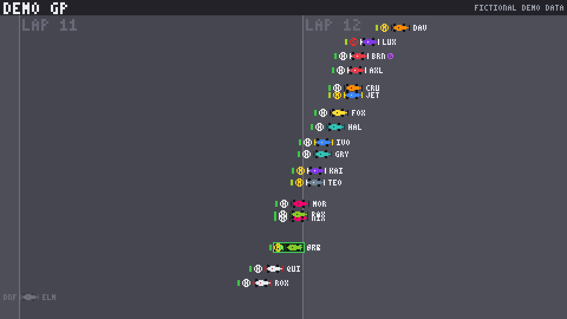
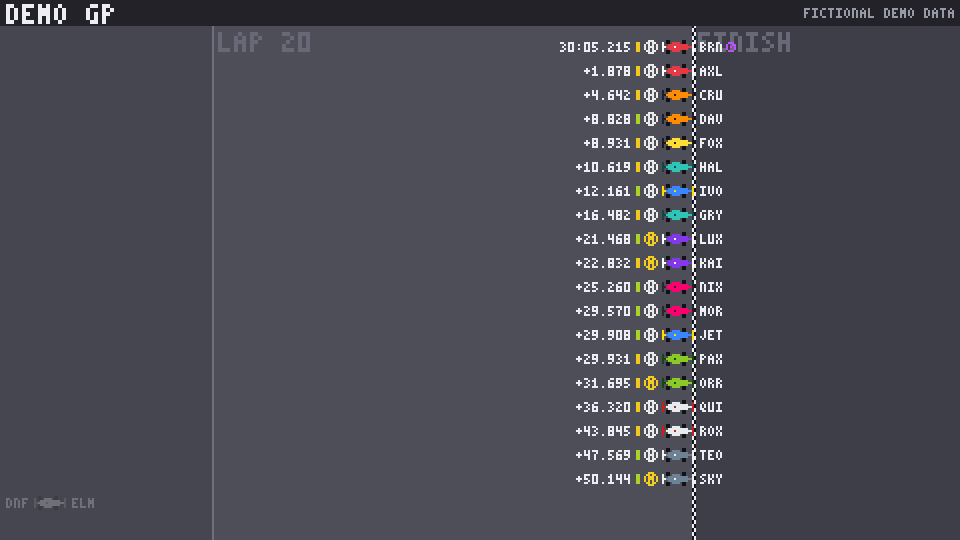
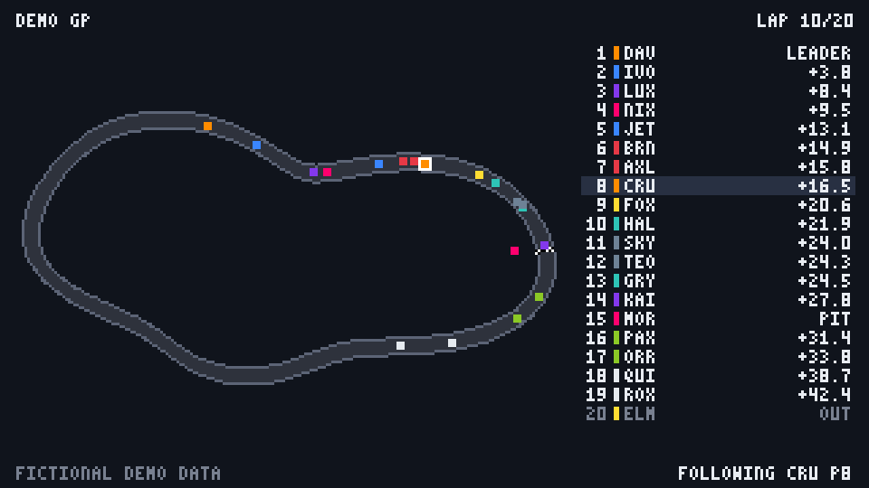

# Pixel Race Replay

Turn a motor race into a short pixel-art replay video. Two views:

- **Timelapse** (default): every car in its own row in race order, sliding
  left or right by how far it is behind the leader, with lap lines scrolling
  past. Each row shows tyre compound and tyre age; there are start lights, an
  "IN PIT" marker, a fastest-lap stopwatch and a finish screen with race
  time and gaps. Cars fighting for a place drift into each other's rows.
- **Map**: cars moving around the circuit with a live leaderboard beside it.

Both export MP4 for YouTube (1920×1080) or for Shorts, Reels and TikTok
(1080×1920), with an optional "follow one driver" highlight.

> **Status: demo data only.** Everything in the current output (the circuit,
> the drivers and the results) is invented by `pixelrace/demo.py`, and every
> frame says **FICTIONAL DEMO DATA**. Real races come next, through a data
> adapter (see [Adding real race data](#adding-real-race-data)).







## Quick start

Needs Python 3.10+ and [ffmpeg](https://ffmpeg.org/) on your `PATH`.

```bash
cd pixel-race-replay
pip install -r requirements.txt

# Timelapse, 1920x1080: start lights, 30 s of race, 3 s on the result
python -m pixelrace --out out/demo.mp4

# Vertical video for Shorts / Reels / TikTok, following one driver
python -m pixelrace --layout portrait --follow CRU --out out/demo-short.mp4

# Track-map view instead
python -m pixelrace --style map --out out/demo-map.mp4

# A single PNG frame, e.g. for a thumbnail (0 = start, 1 = finish)
python -m pixelrace --still 0.5 --out out/halfway.png
```

| Option | Default | Meaning |
| --- | --- | --- |
| `--style` | `timelapse` | `timelapse` (rows sliding by gap) or `map` (cars on the circuit) |
| `--layout` | `landscape` | `landscape` (1920×1080) or `portrait` (1080×1920) |
| `--follow CODE` | none | Highlight one driver on the track and the leaderboard |
| `--duration` | `30` | Seconds of video for the whole race |
| `--hold` | `3` | Seconds to hold on the final classification |
| `--intro` | `2.4` | Seconds of start lights before the race |
| `--fps` | `30` | Frames per second |
| `--scale` | `4` / `6` | Pixel upscale factor; the defaults give 1920×1080 (timelapse 480×270 × 4, map 320×180 × 6) |
| `--laps`, `--seed` | `20`, `7` | Shape of the demo race; the same seed always gives the same race |

A 35-second 1080p video takes about 10 seconds to render and is under 1 MB.

### Reading the timelapse

| On screen | Meaning |
| --- | --- |
| Row order | Race position, P1 at the top |
| Horizontal position | Distance behind the leader; the vertical lines are the start/finish line on each lap |
| Small bar at the left of a row | Tyre age: green = fresh, then yellow, orange, red as the set wears |
| Ring with a letter | Tyre compound: S soft (red), M medium (yellow), H hard (white), I intermediate (green), W wet (blue) |
| Purple stopwatch | Fastest lap so far |
| Green "IN PIT" box | The car is in the pit lane |
| Grey car, "DNF" | Retired |

## How it works

| File | Job |
| --- | --- |
| `pixelrace/model.py` | The `RaceSource` contract every data source fulfils, plus `Driver` and `CarState` |
| `pixelrace/demo.py` | A deterministic fictional race: 20 drivers in 10 teams, random non-crossing circuit, soft/medium/hard tyres with wear, one pit stop each, fastest lap, one retirement, chequered-flag rules |
| `pixelrace/timelapse.py` | The timelapse view: pixel cars, tyre badges, scrolling lap lines, start lights, finish screen |
| `pixelrace/render.py` | The map view, plus the frame timing shared by both views |
| `pixelrace/font.py` | A built-in 3×5 pixel font, so no font files or font licences are needed |
| `pixelrace/video.py` | Pipes frames into ffmpeg and scales them up with nearest-neighbour sampling, so pixels stay square |

## Tests

```bash
cd pixel-race-replay
python -m unittest discover -s tests -t . -v
```

The video test is skipped when ffmpeg isn't installed.

## Adding real race data

The renderer only talks to `RaceSource` (`pixelrace/model.py`). A real-data
adapter needs to provide:

- `track`: the circuit outline as a closed list of `(x, y)` points in racing
  direction, with `track[0]` on the start/finish line;
- `drivers`: code, name, team and livery colours for each car;
- `state_at(t)`: for every car at race time `t`, ordered P1 first: position,
  laps completed, status, gap to the leader, tyre compound and age, whether it
  holds the fastest lap, and its finish time once it has taken the flag.

The timelapse view only needs distances, so it doesn't need the circuit shape.

Candidate data sources (not wired in yet):

- [FastF1](https://docs.fastf1.dev/), an open-source Python library: timing,
  laps, pit stops and car X/Y positions from the 2018 season onward;
- [OpenF1](https://openf1.org/), a free API with car locations from 2023 onward;
- [Jolpica](https://github.com/jolpica/jolpica-f1), which replaced the Ergast
  API, for historical results.

These sources need network access to `livetiming.formula1.com`,
`api.openf1.org` and `api.jolpi.ca`.

## Before you publish

This is not legal advice. Check these points before posting or monetising
videos made with real data:

- **Trademarks.** "Formula 1", "F1", the F1 logo and team names and logos are
  registered trademarks. Describing a race factually (e.g. "2024 Hungarian
  Grand Prix replay") is normal; putting the marks in your channel name, logo
  or branding suggests an official link you don't have.
- **Data rights.** The timing data behind FastF1 and OpenF1 comes from the
  sport's official feed, and both projects are unofficial. There is no public
  licence we know of that allows commercial use. Get advice before
  earning money from it (ads, Patreon, sponsorships).
- **Footage and audio.** Don't add broadcast clips, onboard footage or team
  radio; YouTube's Content ID will flag them.
- **Be original.** Use your own visual style, name and layout, not another
  channel's.
